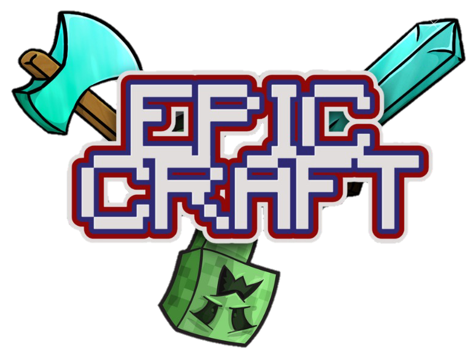

<p align="center">
  
</p>

# Epic Craft — site do mod

Código da página **https://epiccraft.nekyoh.tech**: apresentação do mod e download da versão mais recente, que vem direto do [GitHub Releases](https://github.com/Nekyoh/epiccraft/releases).

- Em **português, inglês e espanhol** (mesmo esquema do nekyoh.tech: `?lang=pt|en|es`, cookie `nekyoh_lang` ou o idioma do navegador).
- **Versões vindas do GitHub** pelo servidor, guardadas em `cache/` por 10 minutos. Se o GitHub cair, a página continua com a última resposta boa.
- **Estável primeiro, beta avisada**:
  - existe versão estável → ela é o download principal; se houver uma *pre-release* mais nova, aparece um aviso "Saiu a beta X" com o botão dela;
  - ainda não existe estável (como agora, na 0.1.0) → a beta é o download principal, marcada como **Beta**, com um aviso de que pode ter bugs.
- **Novidades** da página = o texto da Release no GitHub.
- JavaScript só para o tooltip do inventário; sem ele a página funciona igual.

## Publicar uma versão nova do mod

Não precisa mexer aqui. Quando a Release é **publicada** no GitHub (rascunhos não aparecem), a página atualiza em até 10 minutos.

- Marque **"Set as a pre-release"** para betas. Sem a marca, a versão é tratada como estável.
- O arquivo reconhecido é o `.jar` do mod (o `-sources.jar` é ignorado).

## Links fixos de download

| Link | Leva para |
|---|---|
| `/download` | `.jar` da versão estável (ou da beta, enquanto não houver estável) |
| `/download/beta` | `.jar` da beta mais nova (ou da estável, se não houver beta mais nova) |

Bons para colocar no README do mod, no nekyoh.tech ou em vídeos.

## CurseForge, Modrinth e Wiki

Edite os links em `config.php`. Enquanto um link estiver vazio (`''`), o botão aparece como **Em breve**.

## Estrutura

```
index.php            a página
download.php         links fixos /download e /download/beta
config.php           repositório, links e tempo de cache (edite aqui)
lang/{pt,en,es}.php  textos (incluindo os itens do inventário)
inc/bootstrap.php    idioma e cabeçalhos de segurança
inc/github.php       consulta ao GitHub com cache, separação estável/beta, notas da versão
main.js              tooltip do inventário
style.css            visual
res/                 logo, banner, ícones dos itens e mobs
cache/               resposta do GitHub (gerada no servidor, fora do git)
```

O servidor precisa de **PHP 8.1+** (com `curl` ou `allow_url_fopen`) e a pasta `cache/` com permissão de escrita para o usuário do PHP.

## Licença

Código sob a licença [MIT](LICENSE). Fontes Pixelify Sans e Rubik (Google Fonts, OFL).

Não é um produto oficial do Minecraft. Não aprovado nem associado à Mojang ou à Microsoft.
